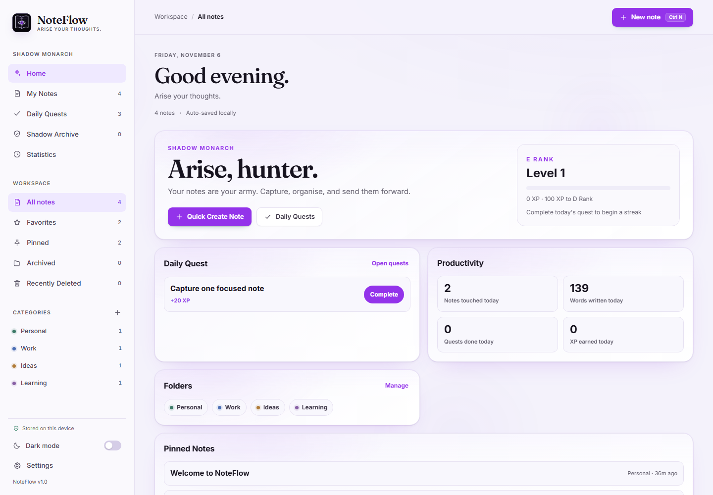
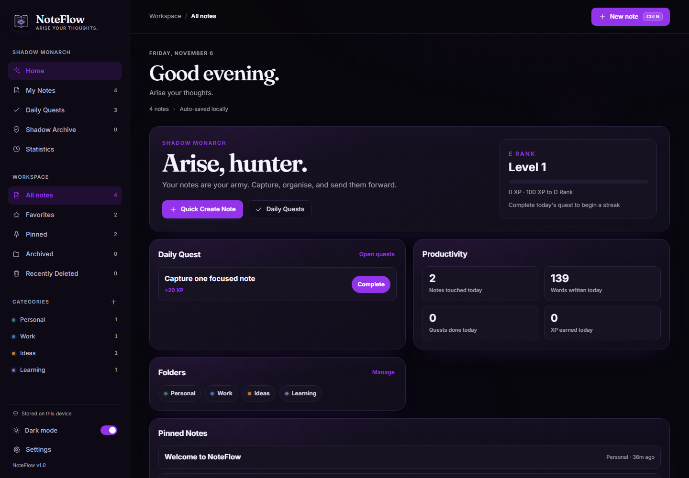
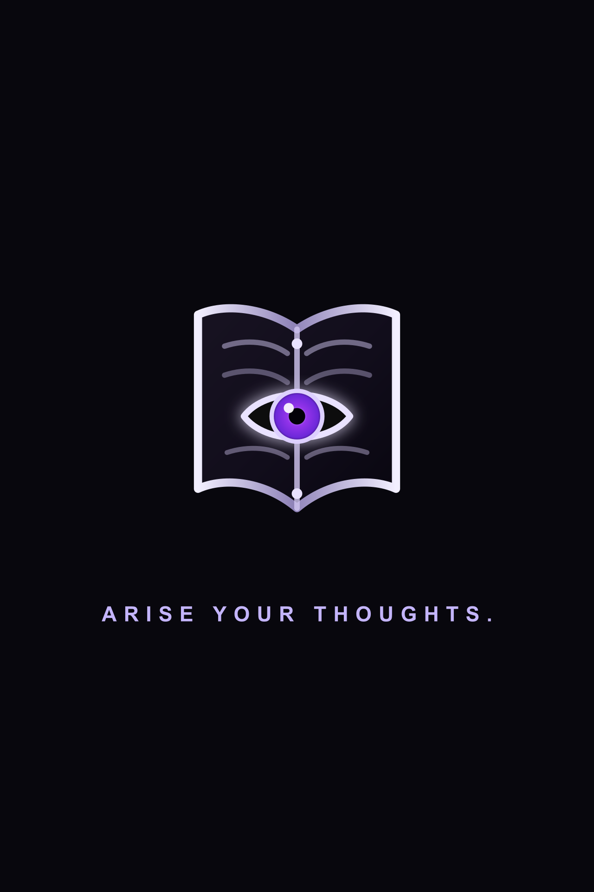

<p align="center">
  
</p>

<h1 align="center">NoteFlow</h1>

<p align="center">
  <strong>Arise your thoughts.</strong><br />
  A local-first notes workspace for web and Android — capture ideas, organize them with categories, and find them again in a keystroke, with no account required.
</p>

<p align="center">
  <a href="#android-app">Android app</a> ·
  <a href="#features">Features</a> ·
  <a href="#screenshots">Screenshots</a> ·
  <a href="#getting-started">Getting started</a> ·
  <a href="#keyboard-shortcuts">Shortcuts</a> ·
  <a href="#project-structure">Structure</a>
</p>


---

## Overview

NoteFlow is a complete note-taking application built with **vanilla HTML5, CSS3, and JavaScript (ES6+)**, now packaged for Android with **Capacitor**. It was designed as a focused alternative to heavyweight note apps: fast to open, quiet to use, and entirely private. Notes autosave to the browser's `LocalStorage`, so there is no backend, no sign-up, and no dependency on internet access for basic functionality.

The interface pairs an original dark-fantasy, Shadow Monarch-inspired identity with practical details — instant search, categories, pinning, favorites, sorting, grid/list layouts, a mobile bottom navigation bar, a floating add-note button, and polished light and dark themes. Every control is wired up, including keyboard shortcuts, imports/exports, native sharing, and confirmation dialogs.

## Android app

The same web codebase is wrapped by Capacitor. The Android project lives in `android/` and uses:

- Application ID: `com.noteflow.app`
- Application name: `NoteFlow`
- Original shadow-notebook logo and adaptive launcher icons
- Native splash screen with the tagline **“Arise your thoughts.”**
- Capacitor plugins for the Android back button, haptics, native share/file export, filesystem writes, and status-bar theming
- Offline-first operation with local persistence and no unnecessary permissions

The Android build copies the web app from `www/` into `android/app/src/main/assets/public`. Run `npm run web:copy` before `npx cap sync android` when web files change; the `cap:sync` script does both.

## Shadow Monarch Edition

Version `1.0.4` adds a premium dark-fantasy productivity layer while preserving the existing note storage format and user data.

### Dashboard and navigation

- Home dashboard with rank, level, XP progress, streak, quick create, daily quest preview, productivity summary, folder shortcuts, pinned notes, and recent notes.
- Mobile-first navigation for Home, My Notes, Daily Quests, Shadow Archive, Statistics, and Settings.
- Desktop sidebar keeps the same sections, with workspace views for All notes, Favorites, Pinned, Archived, and Recently Deleted.

### Daily Quests and XP

- Daily quests reset by the device's local date.
- Add, complete, and remove custom quests.
- XP rewards: create a note `10 XP`, complete a quest `20 XP`, organise a folder `15 XP`, and complete all daily quests for a `50 XP` bonus.
- Duplicate rewards are prevented by note ID, folder ID, quest ID, and daily bonus date.
- Lifetime XP persists across daily resets; ranks progress from E to S.
- Streaks, best streaks, and completed quest history are stored locally.

### Shadow Archive

- Existing categories remain the folder system, preserving current note assignments.
- Notes can be archived, restored, moved to Recently Deleted, restored from trash, or permanently deleted only after confirmation.
- Android delete actions now move notes to trash instead of permanently removing them.
- Missing folders after deletion safely fall back to Uncategorized.

### Statistics

- Real counts for notes, words, folders, pinned notes, archived notes, completed quests, XP, level, rank, streak, and daily productivity.
- Seven-day activity chart computed from stored note update dates.
- Useful empty state for new users with no activity yet.

### Storage

Existing note and category data remains backward compatible. New lifecycle fields are added safely (`archivedAt`, `deletedAt`), and gamification data is stored separately under `noteflow.gamification.v1`.

## Live demo

NoteFlow is a static site and is ready to publish on **GitHub Pages** with no configuration or build step.

> **Live demo:** `https://<your-username>.github.io/<repository-name>/`
>
> Replace the placeholder after publishing with the steps in [Deploy to GitHub Pages](#deploy-to-github-pages). Until then, the app can be opened locally from `index.html`.

## Screenshots

| Light theme | Dark theme |
| :---: | :---: |
|  |  |



> Screenshots show the seeded sample workspace. On first launch, NoteFlow creates four example notes and four categories so the app never starts empty. They can be edited or deleted like any other note.

## Features

### Writing

- **Create, edit, and delete notes** — delete is always confirmed and cannot happen by accident.
- **Autosave** — changes save automatically after a short pause, with a visible “Saved” status. `Ctrl/⌘ + S` triggers an immediate save.
- **Word and character counts** update live while writing.
- **Created and updated timestamps** on every note, with human-friendly relative dates.
- **Empty-note cleanup** — a brand-new note that is closed without a title or content is discarded instead of cluttering the workspace.
- **Export to TXT** — download or share a single note with its title, category, status, dates, and full content. On Android, exports use the native share sheet and filesystem write where available.
- **Unsaved-work protection** — pending edits are flushed when the editor closes or the page unloads.

### Organizing

- **Categories** with eight muted colors, including add, rename, recolor, and delete.
- **Validation and duplicate prevention** — category names are trimmed, length-limited, and must be unique.
- **Safe category deletion** — deleting a category never deletes notes; affected notes become uncategorized.
- **Pin notes** to keep them at the top of any list.
- **Favorite notes** and filter them from the sidebar.
- **Sorting** by last updated, newest, oldest, title A–Z, or title Z–A.
- **Pinned-first ordering** is preserved even when another sort is active.
- **Grid and list layouts**, remembered between sessions.
- **Workspace views** for All notes, Favorites, and Pinned, with live counts.

### Finding

- **Instant search** across both titles and note content as you type.
- **Multi-word search** — tokens can match the title or body in any order.
- **Highlighted matches** and content snippets in the results.
- **Combined filters** — search, category, workspace view, and sort all work together.
- **Clear search** button and empty-search state with a one-click reset.
- **Empty states** tailored to the active view, category, or search.

### Appearance

- **Light, dark, and system themes** with a choice that persists.
- **Flash-free startup** — the saved theme is applied before the first paint.
- **Follows OS changes** automatically while in System mode.
- **Smooth theme cross-fade** with a `prefers-reduced-motion` fallback.
- **Responsive layout** — desktop sidebar, tablet layout, mobile drawer, floating add-note button, and bottom navigation.
- **Android system bars** follow the active theme, and Android back navigation closes dialogs or navigation before exiting the app.
- An original dark-fantasy design system: deep black, violet glow, silver detailing, subtle shadows, rounded cards, and small purposeful animations.

### Data and reliability

- **Local-first storage** — notes, categories, and settings live in the browser.
- **Resilient storage wrapper** — if `LocalStorage` is blocked or full, NoteFlow falls back to in-memory storage and shows a clear warning instead of failing silently.
- **Storage usage indicator** in Settings.
- **JSON backup export** and **validated import** of notes and categories.
- **Delete all notes** with a typed confirmation flow.
- **Toast notifications** for saves, exports, imports, errors, and destructive actions.
- **No duplicate event listeners** — delegated actions keep repeated interactions reliable.

### Accessibility and UX

- Semantic landmarks, skip link, labelled controls, and visible focus rings.
- Fully keyboard-operable cards, dialogs, categories, and navigation.
- Native `<dialog>` elements with focus management and Escape-to-close.
- Live regions for save status and toasts.
- Responsive down to small phones, with no horizontal overflow.
- Reduced-motion support and contrast-checked theme tokens.

## Tech stack

| Layer | Choice |
| --- | --- |
| Markup | Semantic HTML5, inline SVG icon sprite, native `<dialog>` |
| Styles | Modular CSS3 with custom properties, safe-area support, and responsive breakpoints |
| Behavior | Vanilla JavaScript (ES6+), IIFE modules under one namespace |
| Persistence | `LocalStorage` with an in-memory fallback |
| Fonts | Fraunces (display) and Inter (UI) via Google Fonts, with system fallbacks |
| Android | Capacitor 8, Android Gradle Plugin, Gradle, AndroidX |
| Native plugins | App, Filesystem, Haptics, Share, StatusBar |
| Tooling | Node.js, npm, Android Studio or Gradle wrapper |

The app deliberately avoids React, Vue, Angular, and utility frameworks. Modules share the `window.NoteFlow` namespace and load in dependency order with `defer`. The optional `js/native.js` module provides safe web fallbacks when Capacitor plugins are not present.

## Project structure

```text
NoteFlow/
├── index.html              # Application shell, dialogs, and SVG icon sprite
├── capacitor.config.json   # Capacitor app ID, web directory, and Android options
├── package.json            # Node scripts and Capacitor plugin dependencies
├── scripts/
│   └── copy-web.js         # Copies the web app and Capacitor runtime files to www/
├── assets/
│   ├── icons/
│   │   ├── app-logo.png
│   │   ├── favicon.png
│   │   ├── favicon.svg
│   │   ├── noteflow-logo.svg
│   │   └── noteflow-foreground.svg
│   └── images/
│       ├── screenshot-light.png
│       ├── screenshot-dark.png
│       └── android-splash.png
├── css/
│   ├── themes.css          # Light and dark design tokens
│   ├── style.css           # Layout, components, and interaction styles
│   └── responsive.css      # Tablet, mobile, safe areas, and reduced-motion rules
├── js/
│   ├── utils.js            # DOM, date, text, toast, dialog, and download helpers
│   ├── storage.js          # Safe LocalStorage wrapper and error reporting
│   ├── native.js           # Optional Capacitor back-button, share, haptics, and status-bar bindings
│   ├── notes.js            # Note/category data layer, lifecycle, validation, seeding, backups
│   ├── search.js           # Tokenized search, highlighting, and snippets
│   ├── filters.js          # View/category/query/sort state and pinned-first sorting
│   ├── gamification.js     # Daily quests, XP, ranks, streaks, and completion history
│   ├── stats.js            # Real note, folder, quest, XP, and weekly activity statistics
│   ├── editor.js           # Editor lifecycle, autosave, counters, archive, and TXT export/share
│   └── app.js              # Controller: pages, rendering, events, theme, dialogs, navigation
├── www/                    # Generated Capacitor web directory (ignored by Git)
├── android/                # Generated Capacitor Android project
│   ├── app/
│   │   ├── build.gradle    # Android application ID and version
│   │   └── src/main/
│   │       ├── AndroidManifest.xml
│   │       ├── java/com/noteflow/app/MainActivity.java
│   │       └── res/        # Icons, splash screen, themes, and resources
│   ├── build.gradle
│   ├── gradle.properties
│   ├── gradle/
│   └── settings.gradle
├── .gitignore
├── LICENSE
└── README.md
```

### Module responsibilities

- **`utils.js`** — small shared helpers with no business logic: element lookup, debounce, date formatting, escaping, text truncation, file downloads, toasts, and promise-based confirmation.
- **`storage.js`** — namespaced keys, availability detection, guarded reads/writes, memory fallback, usage reporting, and custom storage-error events.
- **`native.js`** — optional Capacitor bindings for Android back navigation, haptics, status-bar theming, and native share/file export. It is a safe no-op on the web.
- **`notes.js`** — the single source of truth for notes and categories/folders: CRUD, validation, seeding, archive/trash lifecycle, backups, and restore validation.
- **`search.js`** — tokenizer, match detection, safe highlighting, and snippet extraction.
- **`filters.js`** — view, category, query, and sort state; applies active, archived, and trashed note filters with pinned-first ordering.
- **`gamification.js`** — daily quest generation, local-date resets, XP rewards with duplicate protection, ranks, streaks, and completion history.
- **`stats.js`** — real productivity statistics and seven-day activity computed from stored app data.
- **`editor.js`** — opens the editor, tracks dirty state, debounces saves, updates counters and dates, archives notes, and exports or shares TXT files.
- **`app.js`** — boots the app, renders every page, wires delegated events, manages the theme, dialogs, settings, backups, keyboard shortcuts, page navigation, dashboard, quests, archive, and statistics.

## Getting started

### Prerequisites for Android

- Node.js 18 or newer and npm
- Android Studio with the Android SDK
- Java 17 or newer

### Run locally

**Option A — open the file directly**

1. Download or clone this repository.
2. Open `index.html` in a modern browser.

The app is fully functional from `file://`; only the Google Fonts request needs a network connection. If fonts are unavailable, the system font stack is used automatically.

**Option B — serve it locally**

```bash
# From the project folder
python -m http.server 8000
# or
npx serve .
```

Then visit `http://localhost:8000`.

### Build the Android app

```bash
npm install
npm run web:copy
npx cap add android
npx cap sync android
npx cap open android
```

To build a debug APK from the command line:

```bash
cd android
./gradlew assembleDebug
```

Expected output:

```text
android/app/build/outputs/apk/debug/app-debug.apk
```

To install the debug APK on a connected device or emulator:

```bash
adb install android/app/build/outputs/apk/debug/app-debug.apk
```

After changing web files, run `npm run cap:sync` before building again so `www/` and the Android assets stay in sync.

### Deploy to GitHub Pages

1. Push the project to a GitHub repository with the default branch set to `main`.
2. Open **Settings → Pages** in the repository.
3. Under **Build and deployment**, choose **Deploy from a branch**.
4. Select `main` and `/ (root)`, then save.
5. Wait for the deployment, then open `https://<your-username>.github.io/<repository-name>/`.

All asset paths are relative, so NoteFlow works from a project subpath without changes. No server, database, or environment variables are required.

## Keyboard shortcuts

`Ctrl` is used on Windows and Linux; `⌘` is used on macOS. Labels in the interface adapt automatically.

| Shortcut | Action |
| --- | --- |
| `Ctrl/⌘ + K` | Focus the search field |
| `Ctrl/⌘ + N` | Create a new note |
| `Ctrl/⌘ + S` | Save the open note immediately |
| `Esc` | Close the editor or dialog, clear search, or close the mobile drawer |
| `Enter` / `Space` | Open the focused note card |

## Data and privacy

NoteFlow stores everything locally. It makes no API calls and sends no note content anywhere.

| Key | Contents |
| --- | --- |
| `noteflow.notes.v1` | Notes, content, timestamps, pin/favorite flags, category IDs |
| `noteflow.categories.v1` | Category names and colors |
| `noteflow.settings.v1` | Theme, default sort, and layout preference |
| `noteflow.meta.v1` | First-run initialization marker |

- **Backups:** use **Settings → Export backup** to download a JSON copy of notes and categories. Import validates the file before replacing local data.
- **Clearing site data** in the browser removes notes permanently. Export a backup first.
- **Network requests:** the only external request is the Google Fonts stylesheet and font files. No analytics, tracking, or note data is transmitted.
- If storage is unavailable, NoteFlow runs for the session and warns that changes will not persist.

## Browser support

NoteFlow targets current evergreen browsers:

- Chrome / Edge 90+
- Firefox 90+
- Safari 15.4+

It relies on ES6 modules patterns, CSS custom properties, `LocalStorage`, `matchMedia`, and the native `<dialog>` element. Older browsers may render the interface but are not supported.

## Accessibility

- WCAG-oriented contrast tokens in both themes.
- Keyboard access to every interactive element, including note cards.
- Focus is trapped and restored naturally by native dialogs.
- `aria-live` announcements for save state and toasts.
- A skip link, landmark regions, and screen-reader-only labels.
- Motion is reduced automatically when the user requests it.

## Future improvements

- Rich text or Markdown editing with a live preview.
- Tags alongside categories, plus saved smart filters.
- Drag-and-drop manual ordering.
- PWA support with a service worker for fully offline first loads.
- Optional end-to-end encrypted sync across devices.
- Bulk selection for move, delete, and export.
- Import from Markdown, plain text, and other note apps.
- Reminders, due dates, and a calendar view.
- Internationalization and localized date formatting.
- Automated tests for the data layer and filter combinations.

## License

Released under the [MIT License](LICENSE).

## Credits

- Typefaces: [Fraunces](https://fonts.google.com/specimen/Fraunces) and [Inter](https://fonts.google.com/specimen/Inter), licensed under the SIL Open Font License.
- Icons: custom inline SVG sprite created for NoteFlow.
- Design and implementation: NoteFlow contributors.

---

<p align="center">
  <sub>Made for focus. No account required.</sub>
</p>
